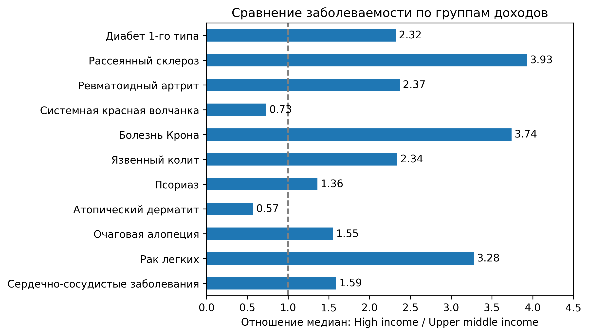
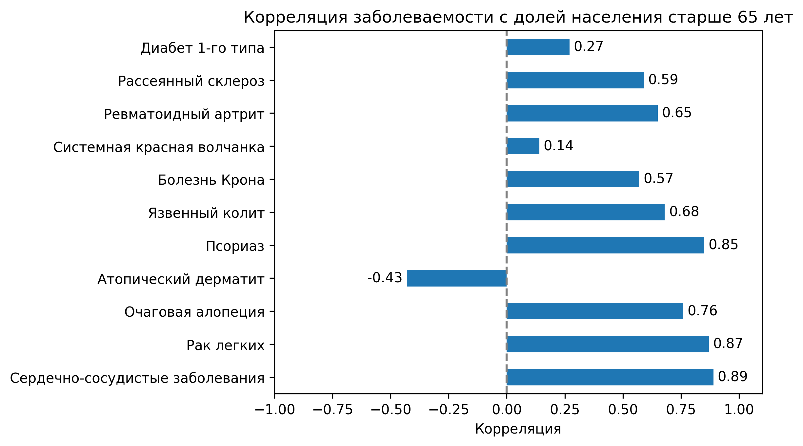
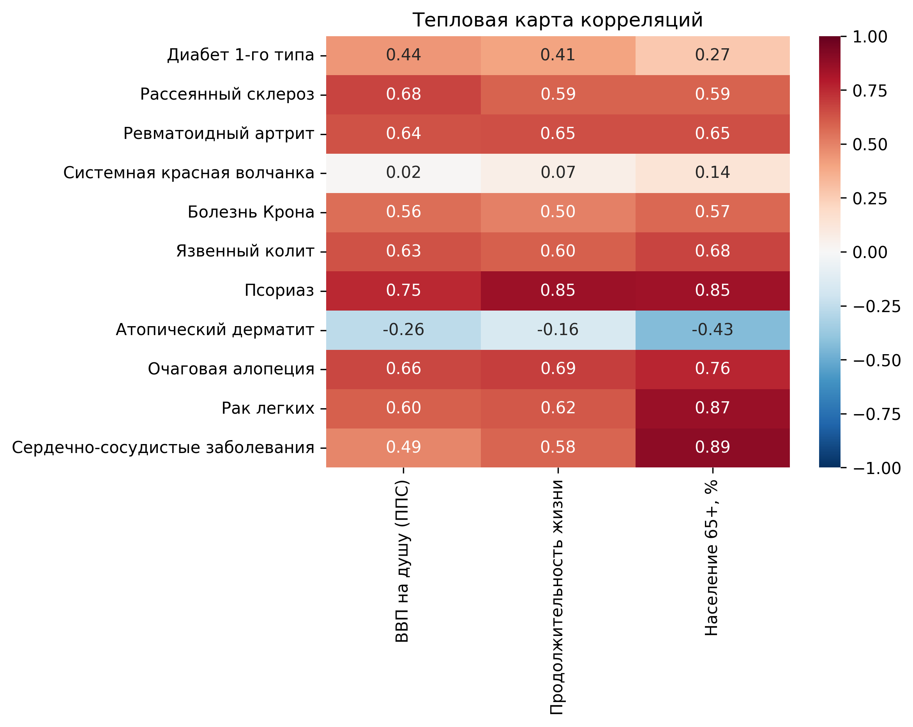

# Global Disease Incidence Analysis

# Исследование географических и социально-экономических различий в заболеваемости аутоиммунными и иммуноопосредованными заболеваниями

## Цель проекта

Проверить гипотезу о повышенной заболеваемости аутоиммунными заболеваниями в странах с высоким уровнем доходов.

Идея исследования возникла после прочтения книги Ади Зусман «Вы это переварите!», в которой обсуждается связь экономического развития, изменений питания и распространения воспалительных заболеваний кишечника.

## Данные и методы

**Источники:** Global Burden of Disease (GBD), World Bank, отдельное международное исследование по системной красной волчанке.

**Период:** преимущественно 2023 год; диабет 1-го типа — 2024 год.

Исследованы девять аутоиммунных и иммуноопосредованных заболеваний. Для контроля дополнительно использованы рак лёгких и сердечно-сосудистые заболевания.

Сравнивались две категории Всемирного банка: High income и Upper middle income. Такой выбор позволил частично уменьшить влияние различий в доступности медицинской диагностики.

Проведены очистка и объединение данных, группировка стран по доходам, сравнение медианных показателей, корреляционный анализ и визуализация географического распределения заболеваний.

**Инструменты:** Python, Pandas, Matplotlib, Seaborn, Jupyter Notebook.

## Основные результаты

- Для семи из девяти заболеваний медианная заболеваемость оказалась выше в группе High income.
- Наибольшие различия обнаружены для рассеянного склероза (3,93 раза) и болезни Крона (3,74 раза).
- Контрольные заболевания также продемонстрировали положительную связь с уровнем дохода.
- Обнаружены существенные корреляции между заболеваемостью отдельными болезнями и возрастной структурой населения.
- На тепловой карте выявлена концентрация высоких показателей ряда аутоиммунных заболеваний в Канаде и странах Северной Европы.

## Основной вывод

**Высокий национальный доход сам по себе не является достаточным объяснением повышенной заболеваемости аутоиммунными заболеваниями.**

На основании географического распределения заболеваний выдвинута гипотеза о возможной роли географической широты, солнечного излучения и обеспеченности витамином D. В научной литературе описан *широтный градиент* рассеянного склероза — увеличение распространённости заболевания по мере удаления от экватора.

С учётом этого можно предположить, что различия между странами могут быть связаны не только с уровнем дохода и качеством диагностики, но и с географическими и экологическими факторами. Однако широтный градиент наиболее убедительно установлен для распространённости рассеянного склероза (prevalence), тогда как в данном исследовании анализировалась заболеваемость (incidence). Влияние широты на полученные результаты требует дополнительной проверки.

Дополнительно рассмотрены особенности питания, окружающей среды, кишечной микробиоты, генетической предрасположенности и образа жизни.

Отдельное ограничение международных сравнений — общенациональные показатели могут сглаживать высокую заболеваемость в северных регионах крупных государств.

Исследование носит описательный характер. Выявленные закономерности позволяют формулировать гипотезы, но не устанавливают причинно-следственные связи.

## Визуализации

### Сравнение заболеваемости по группам доходов

### Корреляция с долей населения старше 65 лет

### Корреляционная матрица

### Географическое распределение девяти заболеваний

## Материалы проекта

[Полное заключение и научные источники](reports/conclusion.md)

[Jupyter Notebook с анализом данных](notebooks/Global_Disease_Incidence_Analysis.ipynb)

## Воспроизведение исследования

Для работы с проектом необходимы Python, Jupyter Notebook и библиотеки `pandas`, `numpy`, `matplotlib`, `seaborn`, `pycountry`, `requests`, `openpyxl`, `xlrd` и `pyarrow`.

Основной файл анализа: `notebooks/Global_Disease_Incidence_Analysis.ipynb`.

Исходные данные получены из Global Burden of Disease (GBD), World Bank и отдельного международного исследования по системной красной волчанке. Для полного повторного запуска необходимо скачать соответствующие наборы данных и разместить их в папке `data/raw/`, сохранив структуру подпапок и имена файлов, используемые в ноутбуке.

Ноутбук следует запускать из папки `notebooks/`. Обработанные данные сохраняются в `data/processed/`, а графики — в `visualizations/`.

В репозитории опубликован итоговый аналитический набор данных, исследовательский ноутбук, графики и подробное заключение. Полный комплект исходных выгрузок в репозиторий не включён.
